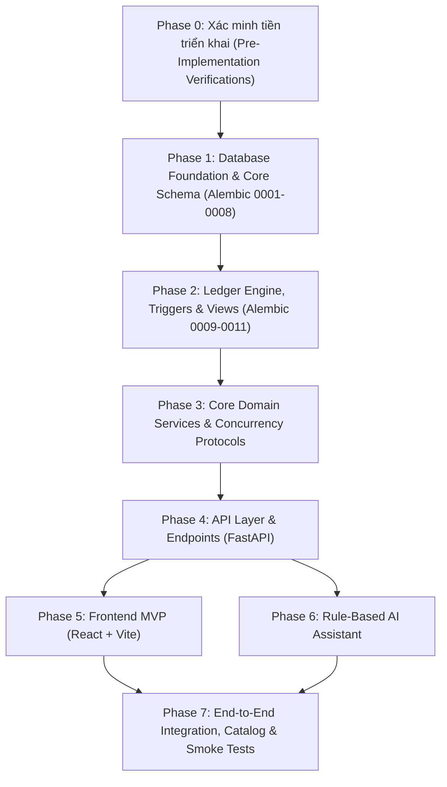

# Implementation Plan: AI Kitchen Inventory Assistant (Revision 6.3 Baseline)

**Trạng thái tài liệu:** Chuẩn bị triển khai (Pre-Implementation Plan - Reviewed & Revised)  
**Kiến trúc tham chiếu (Source of Truth):** `docs/architecture/architecture-revision-6.3.md`  
**Chế độ kiến trúc:** **Core Mode (FROZEN)**  
**D30a Status:** **PROPOSED / DISABLED** (Chỉ triển khai Core migration; các bước tạo role tùy biến, đổi quyền sở hữu, RLS policy cho `app_runtime` theo D30a bị vô hiệu hóa hoàn toàn).

---

## 1. Tổng quan chiến lược triển khai

1. **Nguyên tắc "Ledger-First", "Frozen Core" & Kiến trúc Triển khai:**
   - Triển khai tuần tự từ tầng dữ liệu (Database Schema, Constraints, Triggers, Views) -> Tầng dịch vụ lõi (Domain Services, Concurrency, FEFO, Costing) -> Tầng API (FastAPI Endpoints) -> Tầng giao diện người dùng (React UI) & Trợ lý AI (phát triển song song) -> Tích hợp và kiểm thử E2E.
   - **Định hướng Deployment chuẩn hóa (Giải quyết mục OPEN D20):**
     - *Frontend:* React + TypeScript + Vite, deploy trên **Firebase Hosting** (Google Global CDN, tự động HTTPS).
     - *Backend:* FastAPI modular monolith, đóng gói container deploy trên **Google Cloud Run** (Serverless container, auto-scale).
     - *Database & Auth:* **Supabase PostgreSQL** & **Supabase Auth**.
     - *ORM & Driver:* SQLAlchemy 2.x (sync) + `psycopg 3`.
     - *Migration:* Alembic là cơ quan duy nhất quản lý schema. Tuyệt đối không tạo bảng hoặc thay đổi quyền hạn bằng các script ad-hoc.
     - *CI/CD:* **GitHub Actions** tự động hóa kiểm thử, migration và triển khai.
   - Core mode chạy bằng tài khoản admin/migration owner (`ADMIN_DATABASE_URL`). RLS được bật trên toàn bộ bảng nhưng được bypass bởi chủ sở hữu kết nối (do không dùng `FORCE ROW LEVEL SECURITY`). Tính cô lập dữ liệu phụ thuộc vào application-level kitchen filters, composite FKs và commit-time triggers.

2. **Phân loại bảng dữ liệu theo phạm vi (Data Scoping Hierarchy theo Revision 6.3):**
   - **Bảng dùng chung hệ thống (Shared table, không có `kitchen_id`):** 
     - `units`: Định nghĩa các đơn vị đo lường chuẩn toàn hệ thống (Revision 6.3, mục 3.3.3 xác nhận rõ `units` không có `kitchen_id`, chỉ đọc trong runtime).
   - **Bảng định danh / Quản trị tài khoản (Identity & Tenant root, không có `kitchen_id`):** 
     - `kitchens`, `user_profiles`: Quản trị định danh người dùng và thực thể bếp (Revision 6.3, mục 3.2.6 & FU-1 xác định rõ đây là các bảng không mang `kitchen_id`).
   - **Bảng tenant-scoped (Có `kitchen_id`, kế thừa hợp đồng Revision 3 và ma trận Composite FK Revision 4 mục 4.1):**
     - *Bảng gốc (Parent tenant tables có `kitchen_id`):* `ingredients` (chứa `base_unit_code`, `tracks_expiry`), `dishes`, `recipes`, `sales` (`business_date`), `documents` (`business_date`, `status`), `disposals` (`occurred_on`), `kitchen_settings`, `audit_log`.
     - *Bảng con có Composite Foreign Keys liên kết `kitchen_id`:*
       - `ingredient_unit_conversions`: Composite FK `(kitchen_id, ingredient_id)` trỏ về `ingredients`.
       - `batches`: Composite FK `(kitchen_id, ingredient_id)` trỏ về `ingredients`, có `remaining_qty DEFAULT 0`, `CHECK (remaining_qty >= 0)`.
       - `stock_movements`: Composite FK `(kitchen_id, batch_id)` trỏ về `batches` (lưu snapshot `qty_delta` và `value_vnd`).
       - `recipe_items`: Composite FK `(kitchen_id, recipe_id)` trỏ về `recipes` và `(kitchen_id, ingredient_id)` trỏ về `ingredients`.
       - `sale_lines`: Composite FK `(kitchen_id, sale_id)` trỏ về `sales`, có `CHECK (cogs_vnd >= 0)` và `consumption_status`.
       - `stock_shortages`: Khóa ngoại trỏ về `sale_lines` hoặc `document_lines` cùng `kitchen_id` (Shortage Option C).
       - `document_lines`: Composite FK `(kitchen_id, document_id)` trỏ về `documents` và `(kitchen_id, ingredient_id)` trỏ về `ingredients`.

3. **Phạm vi quyền của Migration 0011 theo đúng Revision 6.3:**
   - **Quy định chính thức của Revision 6.3 (Mục 3.2.6 bước 4, Mục 5 & Mục 6):**
     - Migration 0011 hoàn toàn độc lập với role (`role-independent only`), không chứa câu lệnh điều kiện hay lệnh gán cho bất kỳ role cụ thể nào.
     - Kích hoạt Row Level Security (RLS) trên tất cả các bảng (bao gồm cả bảng dùng chung `units`).
     - Thu hồi toàn bộ quyền (`revoke everything`) từ các role `anon`, `authenticated`, `PUBLIC` trên mọi bảng hiện hữu, view `ledger_effective` và schema `ledger_internal`.
   - **Ranh giới kỹ thuật nghiêm ngặt (không suy diễn mở rộng):**
     - Phạm vi thực thi của Migration 0011 chỉ áp dụng trên **các database objects hiện hữu** được tạo trong các migration từ 0001 đến 0011.
     - **Về Default Privileges:** Revision 6.3 không quy định Migration 0011 thực thi lệnh `ALTER DEFAULT PRIVILEGES`. Khái niệm này chỉ xuất hiện tại Mục 3.2.4 dưới dạng tiêu chí kiểm toán (audit verification) trong bước reconciliation của D30a (đang DISABLED). Do đó, Migration 0011 trong Core mode **không** tự ý thêm các lệnh `ALTER DEFAULT PRIVILEGES`.
     - Migration 0011 **không** chứa bất kỳ chính sách (policy) hay lệnh cấp quyền (`GRANT`) nào cho `app_runtime` hay `ledger_owner` (các nội dung này thuộc D30a bước 5 và đang bị vô hiệu hóa hoàn toàn).

4. **Chiến lược xử lý D30a & Bảo toàn Core Mode:**
   - D30a giữ nguyên trạng thái `PROPOSED / DISABLED`.
   - **Các bước ĐƯỢC triển khai (Core Mode):** Bước 2, 3, 4 trong mục 3.2.6 (Alembic 0001–0011). Schema `ledger_internal`, hàm cache `SECURITY DEFINER` (sở hữu bởi migration owner), trigger kiểm tra tính toàn vẹn (consistency triggers), trigger bất biến đơn vị gốc, và view `ledger_effective` (`security_invoker = true`) đều được triển khai theo baseline.
   - **Các bước BỊ VÔ HIỆU HÓA:** Bước 1 (tạo role `ledger_owner`, `app_runtime`), Bước 5 (reconciliation chuyển quyền sở hữu hàm cache, cấp quyền cột cho `app_runtime`, tạo RLS policy cho tenant), Bước 6 (audit D30a và test T2 với `app_runtime`).
   - **Bảo toàn Core Mode (BẮT BUỘC - MUST):** Backend runtime **bắt buộc** tiếp tục kết nối trực tiếp bằng admin/migration owner role (`ADMIN_DATABASE_URL`). Tuyệt đối **không được tự ý thay thế** bằng bất kỳ custom role nào (như `app_runtime`) khi D30a chưa được mở khóa và FU-1 chưa được đóng. Ranh giới bảo vệ trong Core Mode dựa trên filter ứng dụng, composite FKs và trigger commit.

5. **Nguyên tắc quản lý phạm vi Hackathon (Scope Management):**
   - Nếu đối mặt với áp lực thời gian (24h hackathon), **Stretch scope luôn luôn phải là phần đầu tiên bị cắt giảm, tuyệt đối không được cắt giảm bộ kiểm thử Ledger Core** (Core DB tests L1-L3, C6 và Core Integration tests).
   - Các quyết định OPEN (D7, D9, D9a, D9b, D18, D24, D26 - ngoại trừ D20 đã được giải quyết cụ thể bởi Firebase + Cloud Run) và các tham số placeholder được giữ nguyên trạng thái theo Revision 6.3, không tự ý ấn định giá trị kinh doanh vĩnh viễn.

6. **Kiến trúc Triển khai, Phân tách Kết nối Cơ sở Dữ liệu & Quy trình CI/CD:**
   - **Phân tách kết nối Database (BẮT BUỘC - MUST):**
     - `DATABASE_URL` (Runtime API): Kết nối qua **Supabase Transaction Pooler (Port 6543, Supavisor)** kèm `sslmode=require`. Phục vụ toàn bộ truy vấn runtime từ FastAPI trên Cloud Run.
     - `MIGRATION_DATABASE_URL` (Alembic Migrations): Ưu tiên kết nối qua **Session Pooler (Port 5432)** của Supavisor (hoặc Direct Connection Port 5432 nếu mạng có định tuyến IPv4/IPv6 ổn định qua kiểm chứng U13). Không dùng Transaction Pooler cho migration để tránh lỗi DDL và transaction state.
   - **Quy tắc thực thi Migration (BẮT BUỘC - MUST):**
     - **Tuyệt đối KHÔNG** chạy lệnh `alembic upgrade head` khi container FastAPI khởi động trên Cloud Run. Tránh race condition khi Cloud Run scale-out nhiều instances đồng thời.
   - **Quy trình CI/CD chuẩn qua GitHub Actions (BẮT BUỘC - MUST):**
     - Phân định rõ thứ tự triển khai tuần tự giữa Backend và Frontend để đảm bảo tính sẵn sàng của URL API:
       $$\text{Test (CI)} \longrightarrow \text{Build Backend Image} \longrightarrow \text{Run Migrations (Alembic Port 5432)} \longrightarrow \text{Deploy Backend (Cloud Run)} \longrightarrow \text{Build \& Deploy Frontend (Firebase)}$$
     - *Nguyên tắc bắt buộc:* Backend Cloud Run **bắt buộc được deploy trước** để xác nhận service URL hoạt động ổn định. Sau đó, quy trình build Frontend React + Vite mới nhận URL backend này qua `VITE_API_BASE_URL` và deploy lên Firebase Hosting, loại bỏ rủi ro sai lệch endpoint hoặc gọi nhầm API cũ.
   - **Cấu hình Connection Pool SQLAlchemy khởi điểm (KHUYẾN NGHỊ - SHOULD / Cần Load-test):**
     - Khởi điểm tối ưu cho Supabase Free Tier: `pool_size=2`, `max_overflow=2`, `pool_timeout=10`, `pool_pre_ping=True`, `pool_recycle=300`.
     - *Phân biệt rõ ràng:* Trong kiến trúc Transaction Pooling, số kết nối client từ SQLAlchemy (`instances \times (pool\_size + max\_overflow)`) được kết nối tới Supavisor, trong khi Supavisor chỉ mượn một số lượng nhỏ kết nối PostgreSQL vật lý thực tế trong thời gian transaction hoạt động. Cấu hình này là **khởi điểm an toàn để load-test**, không phải giá trị cố định.
   - **Tắt Server-side Prepared Statements cho psycopg 3 (BẮT BUỘC - MUST / CẦN KIỂM CHỨNG - VERIFY):**
     - Khi chạy trên Transaction Pooler, psycopg 3 bắt buộc phải cấu hình `connect_args={"prepare_threshold": None}` để tắt tự động prepared statements, ngăn ngừa lỗi `prepared statement does not exist` do Supavisor điều phối sang backend process khác; cần kiểm chứng tương thích thực tế trong Phase 0.
   - **Khống chế quy mô Cloud Run (KHUYẾN NGHỊ - SHOULD / CẦN KIỂM CHỨNG - VERIFY):**
     - Cấu hình khởi điểm `--max-instances=3` (SHOULD): Đây là khuyến nghị khởi điểm an toàn để phòng ngừa quá tải kết nối client lên Supavisor và kiểm soát chi phí trong giai đoạn đầu, không phải giá trị bắt buộc cố định (cần load-test thực tế để xác định ngưỡng scale tối ưu).
     - Cấu hình `--min-instances=1` (SHOULD / Tùy chọn) chỉ bật trong thời gian chấm thi/demo để loại bỏ cold start sau khi đã xem xét chi phí phát sinh.
   - **CORS Production tối thiểu (BẮT BUỘC - MUST):**
     - FastAPI `CORSMiddleware` không hỗ trợ wildcard subdomain trong `allow_origins`. Do đó, **bắt buộc cấu hình đích danh** các origin cụ thể của Firebase Hosting sau khi deploy:
       - `allow_origins = ["https://<project-id>.web.app", "https://<project-id>.firebaseapp.com"]` (kèm `http://localhost:5173` khi môi trường là `development`).
       - Nếu cần hỗ trợ các kênh Preview Channels của Firebase Hosting, phải dùng `allow_origin_regex` có giới hạn chặt chẽ: `r"^https://<project-id>(--[a-z0-9-]+)?\.(web\.app|firebaseapp\.com)$"`.
     - Giới hạn methods: `["GET", "POST", "PUT", "PATCH", "DELETE", "OPTIONS"]`.
     - Giới hạn headers: `["Authorization", "Content-Type", "Accept"]`.
     - Cấu hình `max_age=600` để cache preflight request 10 phút, giảm tải cho Cloud Run.
   - **Xác thực JWT cục bộ (Local JWT Verification - BẮT BUỘC - MUST / CẦN KIỂM CHỨNG - VERIFY):**
     - Xác thực chữ ký token dựa trên cấu hình signing key thực tế của Supabase Project (thuật toán HS256 với JWT Secret hoặc RS256/ES256 với JWKS qua kiểm chứng U12).
     - Kiểm tra nghiêm ngặt 5 claims: `iss` (Issuer khớp Supabase Auth URL), `aud` (`authenticated`), `exp` (chưa hết hạn), `role` (`authenticated`), và trích xuất `sub` (User UUID).
   - **Cô lập dữ liệu Bếp (Kitchen Data Isolation - BẮT BUỘC - MUST):**
     - Không chỉ dựa vào việc kiểm tra mã nguồn (Static Code Test). Bắt buộc phải có **Cross-Kitchen Integration Tests** kiểm tra toàn diện cả thao tác đọc, ghi và phòng chống can thiệp tham số (`kitchen_id` tampering). Backend luôn ưu tiên `kitchen_id` từ phiên xác thực, từ chối hoặc ghi đè mọi giá trị `kitchen_id` client tự ý truyền vào.

---

## 2. Các Phase theo thứ tự phụ thuộc



*Ghi chú phụ thuộc:* Sau khi Phase 4 (Tầng API và Dịch vụ nội bộ) ổn định, **Phase 5 (Frontend)** và **Phase 6 (AI Assistant)** có thể được triển khai hoàn toàn **song song**, độc lập với nhau, trước khi hội tụ tại Phase 7 để chạy tích hợp và kiểm thử toàn diện.

---

## 3. Nhiệm vụ chi tiết trong từng Phase

### Phase 0: Xác minh tiền triển khai (Pre-Implementation Verifications)
- **Mục tiêu:** Kiểm chứng các giả định kỹ thuật bắt buộc cho Core trước khi viết migration hoặc code.
- **Nhiệm vụ:**
  1. **Xác minh U1 (PostgreSQL version - MUST / VERIFY):** Kiểm tra phiên bản PostgreSQL trên Supabase và local test container (đảm bảo >= PostgreSQL 15 để hỗ trợ `security_invoker = true` trên view). Nếu < 15: ghi nhận chuyển sang Fallback (parameterized SQL function).
  2. **Xác minh U10 (`pg_trigger_depth` - MUST / VERIFY):** Kiểm tra chính xác giá trị trả về của hàm `pg_trigger_depth()`:
     - Khi gọi ngoài trigger (top-level statement/query): trả về `0`.
     - Trong trigger gọi trực tiếp từ statement: trả về `1`.
     - Trong trigger lồng nhau (trigger được gọi gián tiếp bởi thao tác của một trigger khác): trả về `>= 2`.
     - Xác nhận trigger-depth guard kiểm tra `pg_trigger_depth() < 2` sẽ chặn đúng các câu lệnh cập nhật trực tiếp (độ sâu 1) và cho phép trigger của `stock_movements` cập nhật cache (độ sâu 2).
  3. **Xác minh U12 (Auth Token Signing & Claims - MUST / VERIFY):** Xác định Supabase Auth của dự án đang dùng thuật toán đối xứng (HS256 với JWT Secret) hay bất đối xứng (RS256/ES256 với JWKS); kiểm tra cấu trúc payload token có đủ các claims bắt buộc: `iss`, `aud = 'authenticated'`, `exp`, `role = 'authenticated'`, và `sub`.
  4. **Xác minh U13 (Database Network & Pooler Reachability - MUST / VERIFY):** Kiểm tra kết nối từ môi trường dev và CI/CD tới: (a) Supabase Transaction Pooler (Port 6543) cho `DATABASE_URL` runtime; (b) Session Pooler (Port 5432) hoặc Direct Connection (Port 5432) cho `MIGRATION_DATABASE_URL`; kiểm tra khả năng định tuyến IPv4/IPv6 để đảm bảo không bị chặn mạng.
  5. **Xác minh Alembic Version Table (`NEEDS DECISION`):** Phân tích phụ thuộc kỹ thuật của 2 phương án đặt bảng `alembic_version` đối với test catalog C6 (xem chi tiết mục 9 và 11).
- **Phân loại Scope:**
  - *Must-have:* Hoàn thành xác minh U1, U10, U12, U13; có quyết định cho bảng `alembic_version`.
  - *Minimum Demo Flow:* Đảm bảo kết nối database và trigger depth hoạt động đúng chuẩn.
  - *Can Defer:* Không có (Phase 0 là điều kiện tiên quyết).

### Phase 1: Database Foundation & Core Schema (Alembic 0001–0008)
- **Mục tiêu:** Thiết lập cấu trúc bảng nền tảng, ràng buộc khóa ngoại phức hợp (Composite FK) và kiểm tra toàn vẹn cơ bản.
- **Nhiệm vụ:**
  1. Khởi tạo cấu trúc dự án backend (FastAPI, SQLAlchemy 2.x, psycopg 3, Alembic).
  2. Migration **0001–0004**:
     - Bảng dùng chung: `units` (không có `kitchen_id`).
     - Bảng định danh: `kitchens`, `user_profiles` (không có `kitchen_id`).
     - Bảng nguyên liệu: `ingredients` (có `kitchen_id`, `base_unit_code`, `tracks_expiry`), `ingredient_unit_conversions` (composite FK `(kitchen_id, ingredient_id)`).
  3. Migration **0005–0008**:
     - Lô hàng & kho: `batches` (composite FK `(kitchen_id, ingredient_id)`, `remaining_qty DEFAULT 0`, `CHECK (remaining_qty >= 0)`), `stock_movements` (9 loại movement, quy ước dấu `qty_delta` và `value_vnd`).
     - Bán hàng & công thức: `dishes`, `recipes` (có `kitchen_id`), `recipe_items` (composite FK `(kitchen_id, recipe_id)` và `(kitchen_id, ingredient_id)`), `sales` (có `kitchen_id`), `sale_lines` (composite FK `(kitchen_id, sale_id)`, `CHECK (cogs_vnd >= 0)`, `consumption_status`).
     - Thiếu hàng & chứng từ: `stock_shortages` (Option C), `documents` (có `kitchen_id`), `document_lines` (composite FK `(kitchen_id, document_id)` và `(kitchen_id, ingredient_id)`), `disposals`.
- **Phân loại Scope:**
  - *Must-have:* Toàn bộ schema 0001–0008 với các composite FKs và ràng buộc CHECK.
  - *Minimum Demo Flow:* Bảng sẵn sàng nhận dữ liệu seed cho nguyên liệu, công thức, món ăn và lô hàng.
  - *Can Defer:* Không có.

### Phase 2: Ledger Engine, Triggers & Views (Alembic 0009–0011)
- **Mục tiêu:** Triển khai tầng bảo vệ dữ liệu tự động, cơ chế FEFO, tính toán giá vốn và view `ledger_effective`.
- **Nhiệm vụ:**
  1. Migration **0009**:
     - Tạo schema `ledger_internal`.
     - Tạo hàm cache bảo trì tồn kho (`SECURITY DEFINER`, cố định `search_path = pg_catalog`, sở hữu bởi migration owner).
     - Tạo trigger bảo vệ độ sâu (`pg_trigger_depth() < 2`) trên `batches`.
     - Tạo Deferred Consistency Trigger chạy lúc commit trên `batches` và `stock_movements`: kiểm tra `remaining_qty = Σ qty_delta`, duy nhất 1 dòng `RECEIPT`, `qty_delta = initial_qty`.
     - Tạo Deferred Constraint Trigger cho `sale_lines`, `stock_movements`, `stock_shortages` (xác thực `cogs_vnd` và `consumption_status`).
     - Tạo Trigger chặn thay đổi đơn vị gốc (`base_unit_code`) dựa trên hàm kiểm tra dữ liệu vận hành.
     - Tạo view `ledger_effective` (`security_invoker = true`, phân loại ngày quy kết `attribution_date`).
  2. Migration **0010–0011**:
     - Migration **0010 (Remaining tables):** Tạo các bảng còn lại không thuộc phạm vi phụ thuộc của các trigger trong 0009 (như `kitchen_settings`, `audit_log`).
     - Migration **0011 (RLS & Revokes):** Kích hoạt RLS trên tất cả các bảng (kể cả bảng `units`); thu hồi toàn bộ quyền (`REVOKE ALL`) từ các role `anon`, `authenticated`, `PUBLIC` trên mọi bảng hiện hữu, view `ledger_effective` và schema `ledger_internal`.
  3. **Lưu ý D30a:** Tuyệt đối KHÔNG chạy các script tạo role `app_runtime` / `ledger_owner` hoặc phân quyền RLS theo tenant.
- **Phân loại Scope:**
  - *Must-have:* Hoàn thành migration 0009–0011; Pass Core DB tests (L1, L2, L3, C6 Catalog test).
  - *Minimum Demo Flow:* Nhập kho sinh movement tự động tăng cache; can thiệp trực tiếp vào cache bị từ chối.
  - *Can Defer:* T2 Tests cho `app_runtime` (thuộc Stretch - hoãn lại).

### Phase 3: Core Domain Services & Concurrency Protocols
- **Mục tiêu:** Xây dựng logic nghiệp vụ ở tầng Backend đảm bảo tính toàn vẹn dữ liệu và an toàn đồng thời.
- **Nhiệm vụ:**
  1. **Kitchen Context Middleware & Cách ly dữ liệu (MUST):** Trích xuất `kitchen_id` từ phiên xác thực và inject vào mọi service call / repository. Bắt buộc mọi truy vấn repository đều chứa filter `WHERE kitchen_id = :kitchen_id` để ngăn chặn rò rỉ dữ liệu chéo giữa các bếp trong Core Mode (khi RLS đang bị bypass bởi owner role).
  2. **Inventory & FEFO Service:**
     - Triển khai thuật toán chọn lô FEFO: lọc các lô khả dụng theo `usable(batch)`.
     - Khóa dòng đồng thời khi xuất kho: `SELECT ... FOR UPDATE` trên các dòng lô hàng tham gia tiêu hao.
     - Xử lý thiếu hụt (Shortage Option C): tạo bản ghi `stock_shortages` khi không đủ tồn kho.
  3. **Base-Unit Immutability Protocol:**
     - Hàm kiểm tra `has_operational_data(ingredient)` (khớp 100% với logic DB trigger).
     - Khóa chia sẻ `FOR SHARE` trên `ingredients` khi tạo batch, công thức, chứng từ, đơn bán hàng.
     - Khóa độc quyền `FOR UPDATE` trên `ingredients` khi yêu cầu đổi đơn vị gốc.
  4. **Cost Authority Service (`settle_sale_lines`):**
     - Hàm duy nhất được ghi `sale_lines.cogs_vnd` và `consumption_status`. Thực thi trong cùng transaction.
  5. **COOK Exception Logic:**
     - Hỗ trợ chọn lô cụ thể khi nấu ăn; kiểm tra điều kiện nếu lô hết hạn thì bắt buộc phải có quyền `COOK` trong `expired_batch_actions`.
  6. **Replenishment Service (D25):**
     - Tính toán nhu cầu nhập hàng dựa trên `ledger_effective.attribution_date`, trạng thái `usable(batch)` và tham số placeholder.
  7. **Reporting Service (R1, R3):**
     - Tính toán trực tiếp từ `ledger_effective`, xác định cờ `all_actual` và `has_open_shortages`.
- **Phân loại Scope:**
  - *Must-have:* FEFO Service, Immutability Lock Protocol, `settle_sale_lines`, R1/R3 Service, Replenishment RS1, Enforce Kitchen Filter.
  - *Minimum Demo Flow:* Bán hàng trừ kho FEFO; cảnh báo khi thiếu hàng; tính đúng lãi gộp từ view `ledger_effective`.
  - *Can Defer:* Quy trình xử lý giải quyết thiếu hụt bằng `WRITE_OFF_ESTIMATED` (thuộc Stretch); các workflow hao hụt `WASTE`, quyên góp `DONATION`.

### Phase 4: API Layer & Endpoints (FastAPI)
- **Mục tiêu:** Cung cấp REST API chuẩn hóa cho Frontend và AI Assistant, tối ưu hóa cho môi trường Serverless Cloud Run.
- **Nhiệm vụ:**
  1. **Cấu hình FastAPI & Kết nối Cơ sở Dữ liệu (MUST):**
     - Thiết lập SQLAlchemy 2.x Engine với `DATABASE_URL` trỏ vào Supabase Transaction Pooler (Port 6543) kèm `sslmode=require`.
     - Cấu hình Connection Pool khởi điểm: `pool_size=2`, `max_overflow=2`, `pool_timeout=10`, `pool_pre_ping=True`, `pool_recycle=300`. (Ghi nhận: Đây là cấu hình ban đầu an toàn cho serverless; **không cố định**, cần load-test thực tế).
     - Cấu hình driver `psycopg 3`: `connect_args={"prepare_threshold": None}` (MUST) để tắt prepared statements phía server khi dùng Transaction Pooler; kiểm chứng tương thích (VERIFY).
     - Cấu hình **CORS Production tối thiểu (MUST)**: `allow_origins` nhận danh sách origin chính xác của Firebase Hosting sau khi deploy (`["https://<project-id>.web.app", "https://<project-id>.firebaseapp.com"]` và `http://localhost:5173` khi dev). Không dùng wildcard subdomain. Nếu hỗ trợ preview channels, sử dụng `allow_origin_regex` có giới hạn chặt chẽ (`r"^https://<project-id>(--[a-z0-9-]+)?\.(web\.app|firebaseapp\.com)$"`). Giới hạn methods, headers và cấu hình `max_age=600`.
     - Cấu hình **Local JWT Verification Dependency (MUST)**: xác thực chữ ký token theo signing key thực tế của Supabase (HS256 vs RS256 qua U12), kiểm tra nghiêm ngặt `iss`, `aud`, `exp`, `role`, `sub`.
     - **Quy tắc bắt buộc (MUST):** Tuyệt đối KHÔNG chạy lệnh `alembic upgrade head` trong sự kiện khởi động (startup) của FastAPI.
     - Chuyển đổi lỗi DB trigger thành HTTP 409 chuẩn: `BASE_UNIT_LOCKED`, `ACTION_NOT_PERMITTED_FOR_EXPIRED_BATCH`, `LOCK_TIMEOUT`, v.v.
  2. Endpoints Quản lý danh mục: Nguyên liệu, Đơn vị, Quy đổi, Món ăn, Công thức.
  3. Endpoints Kho & Nhập hàng: Nhập kho thủ công, Danh sách tồn kho theo lô, Tra cứu hạn sử dụng.
  4. Endpoints Bán hàng & Nấu ăn: Tạo đơn bán (`sales/confirm`), Nấu ăn (`cook`), Danh sách thiếu hụt và giải quyết thiếu hụt (`CONSUME_FROM_STOCK`, `WAIVE`).
  5. Endpoints Báo cáo & Đề xuất: Báo cáo R1 (lãi lỗ/giá vốn kỳ), Báo cáo R3 (chi tiết món), Gợi ý nhập hàng (RS1).
  6. Seed & Reset script: Nạp dữ liệu mẫu ban đầu cho 1 kitchen chuẩn phục vụ demo.
- **Phân loại Scope:**
  - *Must-have:* Cấu hình Engine/Pooler an toàn, Local JWT auth, CORS tối thiểu, các endpoints CRUD danh mục, nhập kho, xác nhận bán hàng, giải quyết thiếu hụt, báo cáo R1/R3, gợi ý RS1.
  - *Minimum Demo Flow:* API phản hồi đầy đủ cho kịch bản: Nhập hàng -> Nấu món -> Bán hàng -> Xem báo cáo.
  - *Can Defer:* Endpoints cho các loại movement Stretch (`ADJUSTMENT`, `SELL_OFF`, `DONATION`).

### Phase 5: Frontend MVP (React + TypeScript + Vite)
- **Mục tiêu:** Giao diện trực quan cho quản lý bếp, tuân thủ các quy định hiển thị số liệu ước tính, deploy trên Firebase Hosting.
- **Lựa chọn Styling:** `NEEDS DECISION` (CSS Framework/Styling solution như Tailwind CSS, CSS Modules, hoặc component library cần được người dùng phê duyệt trước khi cài đặt).
- **Nhiệm vụ:**
  1. Khởi tạo dự án React + TS + Vite; cấu hình API Client kết nối Cloud Run Backend URL; cấu hình Firebase Hosting (`firebase.json`).
  2. Màn hình Dashboard & Tồn kho: Danh sách nguyên liệu, các lô hàng, phân loại hạn sử dụng (`EXPIRED`, `EXPIRES_SOON`, `OK`, `NO_EXPIRY`).
  3. Màn hình Bếp & Nấu ăn: Gợi ý món có thể nấu (`suggested_dishes`), giao diện nấu ăn chọn lô cụ thể.
  4. Màn hình Bán hàng & Thiếu hụt: Xác nhận bán hàng, danh sách các ca thiếu hàng mở và nút giải quyết (`CONSUME_FROM_STOCK`, `WAIVE`).
  5. Màn hình Báo cáo Lãi lỗ (R1/R3):
     - **Bắt buộc:** Gắn nhãn `ESTIMATE` rõ ràng cho mọi số liệu có chứa ước tính (`including_estimates_vnd`).
     - Hiển thị cảnh báo "Chi phí chưa hoàn tất" khi `has_open_shortages = true`.
  6. Màn hình Đề xuất nhập hàng (RS1): Xem danh sách đề xuất mua nguyên liệu theo công thức.
- **Phân loại Scope:**
  - *Must-have:* Màn hình Tồn kho, Nấu/Bán hàng, Báo cáo R1 với nhãn `ESTIMATE`, Đề xuất RS1, build deploy Firebase Hosting.
  - *Minimum Demo Flow:* Thao tác trực tiếp từ UI: Nhập nguyên liệu -> Bán món -> Thấy kho giảm -> Xem báo cáo chi phí.
  - *Can Defer:* Màn hình quản lý tài liệu phức tạp, giao diện dark mode hoặc animation nâng cao.

### Phase 6: Rule-Based AI Assistant
- **Mục tiêu:** Trợ lý thông minh hỗ trợ vận hành bếp, chạy bằng provider mặc định không phụ thuộc bên ngoài.
- **Nhiệm vụ:**
  1. Xây dựng AI Orchestrator độc lập nhà cung cấp (Provider-independent interface).
  2. Triển khai Default Rule-Based Provider (phân tích dữ liệu tồn kho, hạn dùng, thiếu hàng và trả lời theo mẫu chuẩn).
  3. Định nghĩa các tool nội bộ cho AI: tra cứu tồn kho khả dụng (`usable`), kiểm tra món nấu được, gợi ý nhập hàng.
- **Phân loại Scope:**
  - *Must-have:* Rule-based provider phản hồi chính xác câu hỏi về tồn kho, cảnh báo hết hạn và món có thể nấu.
  - *Minimum Demo Flow:* Người dùng hỏi "Hôm nay nấu được món gì?" hoặc "Nguyên liệu nào sắp hết hạn?" -> AI trả lời khớp dữ liệu DB.
  - *Can Defer:* Tích hợp External LLM (OpenAI, Gemini Live - thuộc Deferred).

### Phase 7: End-to-End Integration, Catalog & Smoke Tests, CI/CD Pipeline
- **Mục tiêu:** Đảm bảo toàn bộ hệ thống hoạt động ổn định, vượt qua các bài kiểm thử Core và tự động hóa triển khai qua GitHub Actions.
- **Nhiệm vụ:**
  1. Chạy toàn bộ bộ test Core DB (L1, L2, L3, C6 catalog test, các trigger ràng buộc).
     - Chạy **View Isolation Test (MUST)**: Fixture hai kitchen độc lập có dữ liệu trùng lặp; xác nhận 100% truy vấn từ view `ledger_effective` chỉ trả về đúng dữ liệu của kitchen đang xét.
     - Chạy **Static Code Test (MUST)**: Quét toàn bộ repository methods để khẳng định 100% truy vấn có chứa tham số `kitchen_id`.
     - Chạy **Cross-Kitchen Read/Write & Tampering Integration Test (MUST)**: Kiểm tra cô lập dữ liệu liên bếp trên API thực tế:
       - *Kiểm tra READ:* User Kitchen A truy vấn dữ liệu (tồn kho, đơn hàng, báo cáo) của Kitchen B -> Bị từ chối (HTTP 403 hoặc 404/kết quả rỗng).
       - *Kiểm tra WRITE:* User Kitchen A tạo/sửa dữ liệu (nhập hàng, bán hàng, resolve shortage) kèm ID lô hàng hoặc chứng từ của Kitchen B -> Bị từ chối và rollback toàn diện.
       - *Kiểm tra Tampering:* User cố tình can thiệp tham số query hoặc body thành `kitchen_id` khác -> Backend Auth Dependency bắt buộc phát hiện và chặn đứng (HTTP 403) hoặc cưỡng chế ghi đè bằng `kitchen_id` hợp lệ từ authenticated JWT / UserProfile.
       - *Nguyên tắc:* Tuyệt đối không chỉ dựa vào Static Code Check mà bắt buộc phải có Integration Test chạy thực tế trên API.
  2. Chạy bộ test Core Integration (FEFO, concurrency, rollback tồn kho âm, immutability, settle cogs, R1/R3 flags).
  3. Thực hiện kịch bản chạy thử demo (Demo runbook) hoàn chỉnh.
  4. **Thiết lập CI/CD Pipeline & Triển khai Production (MUST):**
     - Thiết lập GitHub Actions workflow tự động theo thứ tự tuần tự bắt buộc:
       $$\text{Test (Core DB \& Integration)} \longrightarrow \text{Build Backend Image} \longrightarrow \text{Run Migrations (Alembic Port 5432)} \longrightarrow \text{Deploy Backend (Cloud Run)} \longrightarrow \text{Build \& Deploy Frontend (Firebase)}$$
     - *Phân định triển khai:* Backend Cloud Run phải được deploy trước để có URL hoạt động; sau đó Frontend Vite build được inject `VITE_API_BASE_URL` rồi mới deploy lên Firebase Hosting.
     - Cấu hình Cloud Run: Cấu hình khởi điểm `--max-instances=3` (SHOULD / Cần load-test) để khống chế số kết nối client ban đầu lên Supavisor; `--min-instances=1` (SHOULD/Tùy chọn) chỉ bật trong thời gian demo sau khi xem xét chi phí. Phân biệt rõ số kết nối client từ SQLAlchemy pool với số kết nối PostgreSQL vật lý do Supavisor quản lý.
- **Phân loại Scope:**
  - *Must-have:* 100% Core DB tests, View Isolation Test, Cross-Kitchen Read/Write & Tampering Integration Test, và Core Integration tests passed; CI/CD deploy tuần tự tự động thành công; Demo runbook hoạt động trơn tru.
  - *Minimum Demo Flow:* Kịch bản Demo Hackathon hoàn chỉnh trên live URL Firebase Hosting kết nối Cloud Run Backend trong 5–7 phút.
  - *Can Defer:* Không có.

---

## 4. Phân chia trách nhiệm giữa Database, Backend, Frontend và AI

| Hạng mục / Module                | Database (Supabase PostgreSQL + Alembic)                     | Backend (FastAPI + SQLAlchemy trên Cloud Run)                    | Frontend (React + TS + Vite trên Firebase)               | AI Assistant (Rule-Based)                |
| :------------------------------- | :----------------------------------------------------------- | :--------------------------------------------------------------- | :------------------------------------------------------- | :--------------------------------------- |
| **Hạ tầng & Triển khai**         | Supavisor Pooler (Port 6543 runtime, Port 5432 migration).   | Container serverless trên Cloud Run (`--max-instances=3` khởi điểm SHOULD). | Static hosting trên Firebase Hosting (Global CDN, HTTPS).| Chạy trong container backend.            |
| **Authentication & Context**     | Lưu trữ `user_profiles`, `kitchens`.                         | Middleware trích xuất và xác thực `kitchen_id`, verify JWT cục bộ.| Quản lý token Supabase Auth, lưu phiên đăng nhập.       | Kế thừa kitchen context từ request.      |
| **Bảo vệ Sổ cái (Ledger Guard)** | Trigger độ sâu, deferred consistency triggers, sign CHECKs.  | Quản lý transaction, xử lý exception khi vi phạm trigger.        | Hiển thị thông báo lỗi rõ ràng nếu bị từ chối.           | Không can thiệp ghi sổ cái.              |
| **Tồn kho & FEFO**               | Lưu trữ `batches`, `stock_movements`. Cache `remaining_qty`. | Thực thi thuật toán chọn lô FEFO, khóa dòng `FOR UPDATE`.        | Hiển thị trạng thái lô, cảnh báo hạn dùng.               | Tool tra cứu tồn khả dụng (`usable`).    |
| **Đơn vị & Bất biến**            | Check trigger `has_operational_data`, FK checks.             | Quản lý quy đổi, Share-lock protocol `FOR SHARE` / `FOR UPDATE`. | Form chọn đơn vị hợp lệ, disable khi đã khóa.            | Tự động chuẩn hóa đơn vị khi gợi ý.      |
| **Giá vốn & Thiếu hụt**          | Deferred trigger khớp COGS và shortages.                     | Hàm `settle_sale_lines`, xử lý giải quyết thiếu hụt Option C.    | Màn hình giải quyết thiếu hụt, hiển thị trạng thái COGS. | Cảnh báo khi có thiếu hụt tồn đọng.      |
| **Báo cáo & Tái nhập**           | View `ledger_effective` (`security_invoker`).                | Tính toán R1, R3, công thức replenishment D25.                   | Render báo cáo, bắt buộc dán nhãn `ESTIMATE`.            | Tóm tắt tình hình chi phí & đề xuất mua. |

---

## 5. Các file/module dự kiến được tạo hoặc chỉnh sửa

```
kitchen-assistant/
├── .github/
│   └── workflows/
│       ├── deploy-backend.yml                    # CI/CD: Test (Core DB & Integration) -> Build Image -> Migration (Port 5432) -> Deploy Cloud Run
│       └── deploy-frontend.yml                   # CI/CD: Deploy Firebase Hosting sau khi Backend Cloud Run sẵn sàng (inject VITE_API_BASE_URL)
├── docs/
│   ├── architecture/
│   │   └── architecture-revision-6.3.md          # [Source of Truth - READ ONLY]
│   └── implementation/
│       └── implementation-plan.md                # [Tài liệu này]
├── backend/
│   ├── Dockerfile                                # Container packaging cho Cloud Run
│   ├── alembic/
│   │   ├── versions/
│   │   │   ├── 0001_initial_units_and_tenants.py # [Mới] Phase 1
│   │   │   ├── ...                               # [Mới] Phase 1
│   │   │   ├── 0009_ledger_internal_and_core.py  # [Mới] Phase 2: triggers, ledger_effective
│   │   │   ├── 0010_remaining_tables.py          # [Mới] Phase 2
│   │   │   └── 0011_enable_rls_and_revokes.py    # [Mới] Phase 2: RLS & Revoke role ngoài
│   │   └── env.py
│   ├── app/
│   │   ├── core/
│   │   │   ├── config.py                         # Cấu hình pool, CORS, JWT claims, tham số placeholder
│   │   │   ├── database.py                       # SQLAlchemy engine (NullPool/QueuePool, prepare_threshold=None)
│   │   │   └── exceptions.py                     # Custom domain exceptions
│   │   ├── models/                               # SQLAlchemy ORM models
│   │   │   ├── tenant.py                         # Kitchen, UserProfile
│   │   │   ├── unit.py                           # Unit, Conversion
│   │   │   ├── inventory.py                      # Batch, StockMovement, Disposal
│   │   │   ├── recipe.py                         # Dish, Recipe, RecipeItem
│   │   │   ├── sale.py                           # Sale, SaleLine, StockShortage
│   │   │   └── document.py                       # Document, DocumentLine
│   │   ├── repositories/                         # Kitchen-scoped data access (bắt buộc filter kitchen_id)
│   │   ├── services/                             # Domain logic
│   │   │   ├── inventory_service.py              # FEFO logic, receipt, movements
│   │   │   ├── unit_service.py                   # Immutability lock protocol
│   │   │   ├── sale_service.py                   # settle_sale_lines, cook exception
│   │   │   ├── replenishment_service.py          # D25 formula
│   │   │   └── reporting_service.py              # R1, R3 calculation from view
│   │   ├── api/v1/                               # FastAPI Routers (CORS tối thiểu, auth dependency)
│   │   └── ai/
│   │       ├── provider.py                       # Base AI Interface
│   │       └── rule_based_provider.py            # Default implementation
│   └── tests/
│       ├── db/                                   # Core DB Tests (L1, L2, L3, C6, view isolation, static check)
│       └── integration/                          # Core Integration Tests
└── frontend/
    ├── firebase.json                             # Cấu hình Firebase Hosting
    ├── src/
    │   ├── api/                                  # API Client calls
    │   ├── components/                           # UI Components (EstimateBadge, etc.)
    │   ├── pages/                                # Dashboard, Inventory, Cook, Sales, Reports
    │   └── types/                                # TypeScript interfaces
    └── package.json
```

---

## 6. Điều kiện đầu vào và tiêu chí hoàn thành từng Phase

| Phase       | Điều kiện đầu vào (Entry Criteria)                       | Tiêu chí hoàn thành (Exit Criteria)                                                                             |
| :---------- | :------------------------------------------------------- | :-------------------------------------------------------------------------------------------------------------- |
| **Phase 0** | Quyết định triển khai dự án được duyệt.                  | Xác minh xong U1, U10, U12 (thuật toán & claims JWT), U13 (kết nối mạng port 6543 và 5432); có quyết định kỹ thuật cho bảng `alembic_version`. |
| **Phase 1** | Phase 0 hoàn tất.                                        | Alembic chạy thành công 0001–0008; cấu trúc bảng và composite FKs được tạo chuẩn xác.                           |
| **Phase 2** | Phase 1 hoàn tất.                                        | Chạy thành công 0009–0011; Pass test L1, L2, L3; Pass Catalog test C6; View `ledger_effective` hoạt động.       |
| **Phase 3** | Phase 2 hoàn tất.                                        | Pass toàn bộ unit/concurrency tests của Domain Services: FEFO lock, Share-lock đơn vị gốc, `settle_sale_lines`. |
| **Phase 4** | Phase 3 hoàn tất.                                        | Tất cả Core endpoints phản hồi đúng HTTP status; Engine kết nối Transaction Pooler với `prepare_threshold=None`; CORS production tối thiểu; không có migration lúc startup; Seed/Reset script tạo được môi trường demo. |
| **Phase 5** | Phase 4 API sẵn sàng (phát triển song song với Phase 6). | UI tải được dữ liệu từ Cloud Run, thực hiện luồng nhập kho, nấu, bán hàng; nhãn `ESTIMATE` hiển thị đúng 100%; build Firebase Hosting thành công. |
| **Phase 6** | Phase 4 API sẵn sàng (phát triển song song với Phase 5). | AI phản hồi chính xác dựa trên dữ liệu thật của kho qua rule-based provider.                                    |
| **Phase 7** | Cả Phase 5 và Phase 6 hoàn tất.                          | Pass 100% Core DB Tests, View Isolation Test (hai kitchen), Cross-Kitchen Read/Write & Tampering Integration Test, và Core Integration Tests; Pipeline CI/CD deploy tự động theo thứ tự tuần tự (Backend rồi Frontend); Demo runbook hoạt động trơn tru trên live URL. |

---

## 7. Kế hoạch kiểm thử tương ứng

### 1. Core DB Tests (Chạy tự động trong CI sau migration)
- **L1 (Giới hạn của guard - Revision 6.3 mục 3.1):**
  - Tạo trigger kiểm thử trên bảng nháp (scratch table) thực hiện câu lệnh cập nhật `batches.remaining_qty`.
  - Trigger này chạy ở độ sâu 2 (`pg_trigger_depth() = 2`), do đó vượt qua guard kiểm tra độ sâu (chứng minh guard không xác thực danh tính trigger).
  - Khẳng định giao dịch **bắt buộc thất bại tại commit** bởi deferred consistency trigger.
  - Khẳng định rằng một thay đổi song hành nhằm giữ cache bằng $\Sigma$ là bất khả thi nếu không có dòng ledger tương ứng.
- **L2 (Chặn trực tiếp - Revision 6.3 mục 3.1):**
  - Câu lệnh cập nhật trực tiếp `batches.remaining_qty` từ `DO` block hoặc hàm thông thường kích hoạt trigger trên `batches` ở độ sâu 1 (`pg_trigger_depth() = 1`).
  - Guard kiểm tra `pg_trigger_depth() < 2` phát hiện độ sâu 1 và từ chối câu lệnh ngay lập tức.
  - Báo cáo kiểm thử ghi nhận rõ ràng: kiểm thử này chỉ bao quát các đường dẫn trực tiếp (direct paths only), không phải ranh giới bảo mật.
- **L3 (Allowlist schema test - Revision 6.3 mục 3.1):**
  - Quét danh mục PostgreSQL (`pg_catalog`) để liệt kê toàn bộ trigger và hàm có tham chiếu đến `batches`.
  - Khẳng định chỉ duy nhất hàm áp dụng biến động kho (`movement apply function` trong `ledger_internal`) mới được phép chứa lệnh `UPDATE batches`.
- **C6 Catalog Test (Revision 6.3 mục 6):**
  - Kiểm tra mọi bảng trong `public` đều đã kích hoạt RLS; mọi view có `security_invoker = true`; các role `anon`, `authenticated`, `PUBLIC` không có bất kỳ quyền nào trên bảng, view hay schema `ledger_internal`.
  - Phụ thuộc vào quyết định đối với bảng `alembic_version` (xem mục 9 và 11).
- **View Isolation Test (Kiểm tra cách ly hai bếp - BẮT BUỘC - MUST):**
  - Tạo fixture kiểm thử với hai kitchen độc lập (Kitchen A và Kitchen B) có dữ liệu nguyên liệu và chứng từ trùng lặp.
  - Thực thi toàn bộ truy vấn báo cáo (R1, R3), bù hàng (RS1) và công cụ assistant qua view `ledger_effective`.
  - Khẳng định 100% kết quả trả về chỉ thuộc về kitchen được thiết lập trong ngữ cảnh phiên, không rò rỉ bất kỳ dòng dữ liệu nào của kitchen còn lại.
- **Static Code Test (Kiểm tra quét mã tĩnh - BẮT BUỘC - MUST):**
  - Quét toàn bộ repository methods trong tầng backend: khẳng định 100% các câu truy vấn và hàm đọc/ghi dữ liệu tenant đều bắt buộc có tham số và điều kiện lọc `kitchen_id`.
- **Cross-Kitchen Read/Write & Tampering Integration Test (Kiểm tra cô lập dữ liệu và chống can thiệp tham số - BẮT BUỘC - MUST):**
  - Thiết lập fixture kiểm thử với hai kitchen độc lập (Kitchen A và Kitchen B) cùng 2 token xác thực JWT tương ứng. Khẳng định tuyệt đối không chỉ dựa vào kiểm tra mã tĩnh mà bắt buộc phải có integration test chạy thực tế trên API endpoints:
  - *Kiểm thử đọc (Read Isolation):* User Kitchen A gửi request truy vấn nguyên liệu, tồn kho, đơn bán, báo cáo thuộc Kitchen B $\rightarrow$ Backend từ chối truy cập (HTTP 403 Forbidden hoặc HTTP 404 / tập dữ liệu rỗng).
  - *Kiểm thử ghi (Write Isolation):* User Kitchen A gửi request tạo/chỉnh sửa biến động kho, nấu ăn, hoặc giải quyết thiếu hụt có tham chiếu `batch_id` hoặc `shortage_id` thuộc Kitchen B $\rightarrow$ Giao dịch bị từ chối và rollback toàn diện.
  - *Kiểm thử can thiệp tham số (Request Tampering):* User Kitchen A cố tình can thiệp giá trị `kitchen_id = Kitchen B` trên URL parameter, query string hoặc JSON request payload $\rightarrow$ Backend Auth Dependency bắt buộc phát hiện và chặn đứng (HTTP 403) hoặc cưỡng chế ghi đè bằng `kitchen_id` hợp lệ trích xuất từ authenticated JWT / UserProfile.
- **Attribution Date Rules:**
  - Kiểm tra ngày quy kết chính xác cho cả 9 loại movement và trường hợp đảo dòng (reversal).

### 2. Core Integration Tests
- **Quy trình Kho & FEFO:** Nhập kho; tiêu hao bán hàng (đủ hàng, qua nhiều lô, thiếu hàng 1 phần); kiểm tra rollback khi tồn kho âm; kiểm tra tính lũy kế của cache tồn kho.
- **Bất biến Đơn vị gốc:**
  - Kiểm tra 6 điều kiện của `has_operational_data`: có batch (kể cả rỗng), movement, recipe, document line chưa hủy, shortage, hoặc conversion -> Đều trả về `409 BASE_UNIT_LOCKED`.
  - Concurrency Test: Luồng đổi đơn vị giữ exclusive lock `FOR UPDATE` buộc luồng chèn batch phải chờ và nhận đơn vị mới; Luồng tạo batch giữ share lock `FOR SHARE` buộc luồng đổi đơn vị chờ và thất bại với `BASE_UNIT_LOCKED`.
- **COGS Cache Reconciliation:** Khớp nối `sale_lines.cogs_vnd` với tổng `-Σ value_vnd` của `SALE_CONSUMPTION`; kiểm tra commit trigger chặn đứng dữ liệu sai lệch.
- **Trạng thái `all_actual` & Báo cáo R1/R3:** Kiểm tra cờ `all_actual` chuyển thành `false` ngay cả khi write-off ước tính là 0 VND; kiểm tra giao diện không bao giờ hiển thị số liệu ước tính mà thiếu nhãn `ESTIMATE`.
- **Tính khả dụng `usable(batch)` & Ngoại lệ COOK:** Kiểm tra lô hết hạn bị loại trừ khỏi FEFO thông thường; kiểm tra ngoại lệ chỉ cho phép nấu lô hết hạn khi có cờ `COOK` trong cấu hình.
- **Bù hàng Replenishment (RS1):** Tính toán đúng cửa sổ quan sát `observed_days` dựa theo `attribution_date`.

---

## 8. Phân loại Core, Stretch và Deferred

| Phân loại                                          | Tính năng & Phạm vi kiểm thử                                                                                                                                                                                                                                                                                                                                                                                                                                                                                                                                                               | Trạng thái triển khai                           |
| :------------------------------------------------- | :----------------------------------------------------------------------------------------------------------------------------------------------------------------------------------------------------------------------------------------------------------------------------------------------------------------------------------------------------------------------------------------------------------------------------------------------------------------------------------------------------------------------------------------------------------------------------------------- | :---------------------------------------------- |
| **CORE (Bắt buộc cho MVP)**                        | - 9 loại movement sổ cái, quy ước dấu, snapshot giá vốn.<br>- Alembic 0001–0011 (Core mode, không role tùy biến).<br>- Trigger-depth guard & Deferred consistency triggers.<br>- View `ledger_effective` (`security_invoker`).<br>- FEFO tự động, Khóa bất biến đơn vị gốc (Share-lock protocol).<br>- Hàm `settle_sale_lines`, thiếu hụt Option C (`CONSUME_FROM_STOCK`, `WAIVE`).<br>- Báo cáo R1, R3, Tái nhập RS1 theo attribution date.<br>- Frontend Dashboard, Inventory, Cook, Sales, Reports.<br>- Rule-based AI Assistant.<br>- Bộ test Core DB (L1-L3, C6) và Core Integration. | **TRIỂN KHAI NGAY**                             |
| **STRETCH (Ưu tiên 2, chỉ làm khi Core hoàn tất)** | - **D30a & Toàn bộ T2 Tests** (Role `app_runtime`, `ledger_owner`, chuyển quyền sở hữu, RLS policies chi tiết theo FU-1, catalog test C2, test L4).<br>- Quy trình điều chỉnh kho (`ADJUSTMENT`), hao hụt (`WASTE`), thanh lý (`SELL_OFF`), quyên góp (`DONATION`).<br>- Ma trận kiểm thử mở rộng cho COOK.<br>- Giải quyết thiếu hụt dạng ghi giảm ước tính (`WRITE_OFF_ESTIMATED`).<br>- Báo cáo nâng cao R2.<br>- Hệ thống thông báo (Notifications).                                                                                                                                   | **TẠM HOÃN** (Chờ đóng FU-1 và hoàn thành Core) |
| **DEFERRED (Hậu Hackathon / Tương lai)**           | - Quy trình phiếu tiêu hao nội bộ (`USAGE_CONSUMPTION` workflows).<br>- Quy trình đảo dòng (reversal) và un-resolve phức tạp ở mức API UI.<br>- Nhập liệu hóa đơn bằng OCR.<br>- Tích hợp External LLM (OpenAI, Gemini Live, v.v.).                                                                                                                                                                                                                                                                                                                                                        | **KHÔNG TRIỂN KHAI**                            |

> **Nguyên tắc quản lý áp lực tiến độ (Hackathon Scope Rule):**  
> Tuân thủ tuyệt đối quy định tại Risk 9 của Revision 6.3: Nếu gặp áp lực thời gian trong 24 giờ hoàn thiện, **Stretch scope luôn luôn phải là phần đầu tiên bị cắt giảm, tuyệt đối không được cắt giảm bộ kiểm thử Ledger Core** (Core DB tests L1-L3, C6 và Core Integration tests). Không tự ý chuyển bất kỳ quyết định FROZEN nào sang Deferred.

---

## 9. Các điểm cần xác minh trước khi triển khai (Verification Checklist)

Trước khi thực hiện các lệnh tạo migration hoặc dựng service, các điểm kỹ thuật sau bắt buộc phải được kiểm chứng:

1. **U1 (PostgreSQL `security_invoker` compatibility - MUST / VERIFY):**
   - *Kiểm tra:* Phiên bản PostgreSQL trên Supabase instance hiện tại có >= 15 hay không?
   - *Hành động nếu không đạt:* Thay thế view `ledger_effective` bằng SQL Function có tham số và giữ nguyên ngữ nghĩa bảo mật.
2. **U10 (`pg_trigger_depth` behavior - MUST / VERIFY):**
   - *Kiểm tra:* Xác nhận giá trị thực tế của `pg_trigger_depth()`: top-level = 0, trigger trực tiếp = 1, trigger lồng nhau >= 2. Xác thực điều kiện guard `< 2`.
3. **U12 (Auth Token Signing & Claims - MUST / VERIFY):**
   - *Kiểm tra:* Xác định Supabase Auth đang dùng JWT thuật toán đối xứng (HS256 với secret) hay bất đối xứng (RS256/ES256 với JWKS); kiểm tra 5 claims bắt buộc khi verify cục bộ: `iss` (khớp Supabase Auth URL), `aud = 'authenticated'`, `exp`, `role = 'authenticated'`, và `sub` (User UUID).
4. **U13 (Supabase Pooler Network & IPv4/IPv6 - MUST / VERIFY):**
   - *Kiểm tra:* Kết nối từ môi trường dev và CI/CD tới: (a) Transaction Pooler (Port 6543) cho runtime `DATABASE_URL`; (b) Session Pooler (Port 5432) hoặc Direct Connection (Port 5432) cho `MIGRATION_DATABASE_URL`; xác nhận khả năng phân giải DNS và định tuyến IPv4/IPv6.
5. **Alembic Version Table Handling (`NEEDS DECISION`):**
   - *Bối cảnh:* Test C6 yêu cầu mọi bảng trong `public` phải kích hoạt RLS và thu hồi quyền từ `anon`, `authenticated`, `PUBLIC`. Bảng `alembic_version` mặc định nằm trong `public`.
   - *Phân tích kỹ thuật Phương án A (Giữ bảng trong `public` và cấu hình ngoại lệ cho test C6):*
     - *Ưu điểm:* Cấu hình chuẩn của Alembic, không phát sinh bước chuẩn bị ngoài.
     - *Phụ thuộc kỹ thuật:* Test C6 phải thêm điều kiện loại trừ: `WHERE tablename != 'alembic_version'`.
   - *Phân tích kỹ thuật Phương án B (Chuyển bảng sang schema khác, ví dụ `ledger_internal`):*
     - *Ưu điểm:* Schema `public` hoàn toàn sạch, test C6 kiểm tra toàn diện mà không cần ngoại lệ.
     - *Phụ thuộc kỹ thuật (Bootstrap Schema Dependency):* Khi Alembic khởi động lần đầu, nó kiểm tra schema chứa version table. Nếu schema đó chưa tồn tại trong PostgreSQL, Alembic sẽ báo lỗi crash trước khi kịp chạy migration 0009 (nơi tạo schema `ledger_internal`). Do đó, phương án B đòi hỏi phải có một bước tiền khởi tạo (DB bootstrap hook) thực thi `CREATE SCHEMA IF NOT EXISTS ...` trước khi Alembic runner được gọi.

---

## 10. Các rủi ro và phương án xử lý

| Rủi ro                                                                | Mức độ     | Phương án xử lý trong kế hoạch                                                                                                                                                                          |
| :-------------------------------------------------------------------- | :--------- | :------------------------------------------------------------------------------------------------------------------------------------------------------------------------------------------------------ |
| **1. Chạy Core Mode bằng Owner Role bỏ qua RLS**                      | Trung bình | BẮT BUỘC giữ nguyên theo Frozen Core; cô lập triệt để ở tầng Repository (`WHERE kitchen_id = :kitchen_id`); ràng buộc toàn vẹn bằng Composite FKs; chạy View Isolation Test (hai kitchen) và Static Check. |
| **2. Bảng `alembic_version` vi phạm test C6**                         | Thấp       | `NEEDS DECISION`: Chờ người dùng quyết định lựa chọn Phương án A (loại trừ trong test C6) hoặc Phương án B (xử lý bootstrap schema cho version table) theo phân tích tại mục 9.                      |
| **3. Cạn kiệt Connection Pool Supabase khi Cloud Run scale-out**      | **Cao**    | Khởi điểm `pool_size=2, max_overflow=2, pool_timeout=10, pool_pre_ping=True, pool_recycle=300` (cần load-test); khống chế Cloud Run `--max-instances=3` (khởi điểm SHOULD, tối đa 12 kết nối client, Supavisor multiplexing kết nối vật lý). |
| **4. Lỗi Prepared Statements khi psycopg 3 dùng Transaction Pooler**   | **Cao**    | Bắt buộc cấu hình driver psycopg 3: `connect_args={"prepare_threshold": None}` để tắt prepared statements phía server; kiểm chứng tương thích (VERIFY).                                               |
| **5. Race condition chạy migration khi container startup**            | **Cao**    | BẮT BUỘC tách rời migration: Tuyệt đối không chạy Alembic lúc container startup; chạy qua bước CI/CD riêng biệt trên GitHub Actions (qua `MIGRATION_DATABASE_URL` port 5432) trước khi deploy.       |
| **6. Đứt gãy kết nối mạng tới Direct Port 5432 do thiếu IPv6**        | Trung bình | Kiểm chứng U13: Ưu tiên trỏ `MIGRATION_DATABASE_URL` vào Session Pooler của Supavisor (Port 5432) có hỗ trợ đầy đủ IPv4/IPv6 thay vì direct connection IPv6-only.                                    |
| **7. Trigger-depth guard bị vượt qua bởi câu lệnh bên ngoài**         | Thấp       | Không coi guard là tường lửa bảo mật danh tính. Dựa hoàn toàn vào Deferred Consistency Trigger lúc commit để phát hiện và rollback mọi giao dịch làm sai lệch tồn kho.                                  |
| **8. Xung đột đồng thời khi đổi đơn vị gốc**                          | Thấp       | Thực thi nghiêm ngặt Share-lock protocol: mọi thao tác nhập/xuất/công thức đều phải lấy khóa `FOR SHARE` trên nguyên liệu trước khi đọc đơn vị; đổi đơn vị lấy khóa `FOR UPDATE`.                       |
| **9. Hiển thị sai lệch số liệu ước tính trên UI**                     | Trung bình | Viết Integration test giao diện (Front-end test) kiểm tra nghiêm ngặt: bất kỳ trường dữ liệu ước tính nào (`including_estimates_vnd`) render ra màn hình mà thiếu nhãn `ESTIMATE` thì test sẽ fail.     |
| **10. Thiếu thời gian hoàn thiện Hackathon (Scope pressure)**         | Cao        | Tuân thủ triệt để phân loại Scope: nếu thiếu thời gian, cắt giảm ngay các mục Stretch (tạm dừng D30a, hoãn các loại movement phụ), **tuyệt đối không cắt giảm bộ test Ledger Core** (Core DB tests). |

---

## 11. Các điểm cần người dùng quyết định (NEEDS DECISION)

1. **Quyết định giải pháp cho bảng `alembic_version` đối với Test Catalog C6:**
   - **Phương án A:** Giữ bảng `alembic_version` trong schema `public`; cấu hình query của kiểm thử catalog C6 thêm điều kiện loại trừ đích danh bảng `alembic_version`.
   - **Phương án B:** Đặt `version_table_schema = 'ledger_internal'` (hoặc schema chuyên biệt) trong `env.py` của Alembic; chấp nhận bổ sung script bootstrap tạo schema trước khi Alembic chạy migration đầu tiên.
   - *Trạng thái:* `NEEDS DECISION` (chờ người dùng chọn phương án dựa trên phân tích phụ thuộc kỹ thuật tại mục 9).

2. **Lựa chọn CSS Framework / Styling cho Frontend:**
   - Revision 6.3 chỉ quy định *React + TypeScript + Vite*, không chỉ định thư viện styling.
   - *Trạng thái:* `NEEDS DECISION` (Người dùng xác nhận sử dụng Tailwind CSS, CSS Modules hay một component library khác).

3. **Ghi nhận quyết định Hạ tầng Triển khai (D20 đã được chốt):**
   - Đã chốt chính thức: **Firebase Hosting (Frontend) + Google Cloud Run (Backend FastAPI) + Supabase PostgreSQL (Database qua Pooler) & Supabase Auth**. Không còn ở trạng thái OPEN.

4. **Xác nhận trạng thái D30a:**
   - Xác nhận Backend sẽ kết nối trực tiếp bằng quyền migration owner/admin credential cho toàn bộ giai đoạn Core MVP, không tạo các role tùy biến hoặc RLS policy của `app_runtime`.

5. **Phê duyệt bắt đầu Phase 0:**
   - Bắt đầu với Phase 0 (Xác minh U1, U10, U12, U13) trước khi khởi tạo code hoặc migration.
